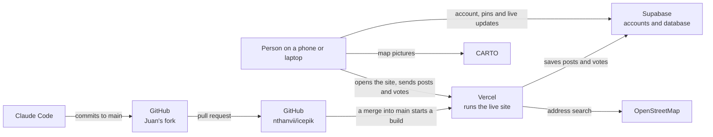

# ICEPik

ICEPik is a map where immigrants in Philadelphia can view ICE sightings and report them anonymously. Other users can then help verify each report. We're building it because ICE alerts spread through family group chats today, and as one person we interviewed put it, "The group chat is fast, but it can't tell you if what someone saw is real."

**Live site:** https://icepik.vercel.app

---

## 1. Where does the code live?

On GitHub, in [nthanvii/icepik](https://github.com/nthanvii/icepik). Vercel deploys the live site from this repo's `main` branch. Juan works in a fork, [jmelv-git/icepik](https://github.com/jmelv-git/icepik), and sends changes back as pull requests. `main` on nthanvii/icepik is always the latest version.

It started as Vercel's Next.js and Supabase starter. We then used Claude Code to build our design mockup on top of it, and connected it to the Supabase database our backend developer designed.

- `app/_components/`: the screens, like the map, the report form and Settings.
- `app/actions/sightings.ts`: posting, voting and deleting, which run on the server.
- `lib/`: the Supabase clients and shared code.
- `database/icepik_schema.sql` and `docs/database-handoff.md`: the database and how to set it up.

## 2. Where does the data live, and what is stored there right now?

Everything is in Supabase, a database with user accounts built in. The tables and their access rules are in `database/icepik_schema.sql`, and `docs/database-handoff.md` explains them and the Supabase settings they need.

- **Accounts:** everyone gets an anonymous account when they first agree to the terms, with no name, email or phone number. Saving it adds a username and password. Supabase stores passwords in a scrambled form, so nobody can read them, including us. The three email accounts the team made while testing the starter are still there too.
- **Sightings:** each pin's location (rounded to about 100 m), street label, category, counts, description, times, and confirmation and dispute totals. Everyone can see a pin while it's on the map, at least 4 hours. Expired pins stay in the database so we can measure how accurate reports are, but the app can't read them.
- **Who posted or voted on a sighting:** kept in two private tables that only that person can read, and deleted within an hour after the pin expires.
- **Profiles:** each account's language setting, and how many sightings it has posted and votes it has cast in total.

Home and work places stay in the browser and never reach the database. The map pictures come from CARTO and the address search from OpenStreetMap, and we don't store anything from them.

The site needs these environment variables, in Vercel and in `.env.local` for `npm run dev`:

| Variable | What it is |
| --- | --- |
| `NEXT_PUBLIC_SUPABASE_URL` | The Supabase project's URL. |
| `NEXT_PUBLIC_SUPABASE_PUBLISHABLE_KEY` | The project's publishable key. The older `NEXT_PUBLIC_SUPABASE_ANON_KEY` works too. Never use the secret or `service_role` key. |
| `NEXT_PUBLIC_CARTO_KEY` | CARTO's free basemap key, from https://carto.com/basemaps/apikey. Without it, every map picture reads "API KEY REQUIRED". |
| `NEXT_PUBLIC_TURNSTILE_SITE_KEY` | Optional. The Cloudflare Turnstile site key, needed only when CAPTCHA is on in Supabase. |

Vercel builds these values into the site, so after adding or changing one, redeploy (Deployments > ⋯ > Redeploy). A production build stops with an error if `NEXT_PUBLIC_CARTO_KEY` is missing, so the live map never shows "API KEY REQUIRED".

Anyone can copy the CARTO key from the page, and our free 5 million map tiles a month count across all our keys, so we use two keys:

- **Vercel's Production environment:** a key restricted in CARTO's dashboard to `icepik.vercel.app`. It shows blank map pictures anywhere else.
- **Vercel's Preview environment and `.env.local`:** a second key with no restriction, because preview addresses change with every branch and CARTO doesn't let one key list both `localhost` and public sites. Anyone who gets hold of it can use our tile quota, so we don't share it.

## 3. How does a change get from Claude Code to the live site?

1. We ask Claude Code to make a change in the code.
2. We check it at `localhost:3000` by running `npm run dev`, with the variables from section 2 in `.env.local`.
3. We commit the change to `main` on Juan's fork and open a pull request into nthanvii/icepik.
4. Someone in our Vercel team authorizes the pull request's preview build, a teammate reviews it, and it's merged into `main`.
5. Vercel sees the new commit on `main` and starts a new build on its own.
6. After about a minute the build shows **Ready** in Vercel, and the change is live at https://icepik.vercel.app.

## 4. What will we need to add to turn this into our team's app?

The first version is built:

- **Accounts:** the terms and privacy notice show before anything loads. Agreeing creates an anonymous account, with no sign-up screen. People can save it with a username and password, log in on another phone, or delete it.
- **Live map:** a map of Philadelphia where a new sighting shows up for everyone within a few seconds, without a refresh. Each pin shows whether it's verified, unverified or disputed, how many people confirmed or disputed it, and how long ago it was posted. Pins leave the map after 4 hours, and each confirmation keeps one there for at least 2 more hours.
- **Posting:** place the pin on the map and choose what you saw. The counts, street names and details are optional, and the street names are suggested for you. If someone already reported a sighting nearby, the form offers to confirm it instead.
- **"Are they still there?":** people within 1 km can confirm or dispute a sighting.
- **Home and work:** saved on the device only, with the number of sightings within 1 mile of each. On a shared phone, "Clear this device" in Settings deletes them and signs out.
- **Know Your Rights:** links to legal resources.

Before we launch it, we need to:

- set up Supabase and the environment variables, as `docs/database-handoff.md` describes;
- add the two CARTO keys to Vercel (see section 2) before the map change is merged. Until then, production builds stop with an error. The keys are free for non-commercial use up to 5 million map tiles a month, and a visit uses about 12 to 90. Above that, CARTO may block the map without notice, so before a wider launch we'll ask support-basemaps@carto.com to raise the limit, which it normally does for free for non-commercial use. CARTO can also withdraw free keys without notice;
- add a rate limit in Vercel's firewall;
- test the handoff's "Done when" list on two real phones;
- have someone review the terms and privacy text, which is a draft.

Still to add:

- **Photos and videos:** a place to store them (Supabase Storage). Before storing a photo, we'll remove the hidden data inside it that can show where it was taken and on what phone.
- **Languages:** a language choice, translated text and a short tutorial on the first visit.
- **A legend** that explains the pin colors.
- **Nearby alerts:** notifications limited to a small area around you. One complaint about the Citizen app was getting alerts from the other side of the country.
- **Reporting harmful posts:** for now, an admin deletes them in Supabase's Table Editor. A report button needs a new table.

Comments are out of scope for this version, as our PRD says.

## 5. Diagram

Posting, voting on and deleting sightings go through Vercel, so Supabase sees Vercel's IP address for them instead of the person's. Address searches and street-name suggestions go through Vercel too. Signing in, loading pins and loading map pictures go straight from the browser, so Supabase and CARTO see the person's IP address for those.

---

## Screenshots

**Sign-up page on the live site, with the web address showing**

**The page we see after logging in**

**Our users in Supabase, under Authentication > Users**

**Vercel showing the deployment is Ready**

**Before our Claude Code changes:** the site was the Next.js Supabase Starter.

**After:** it's the ICEPik map, at https://icepik.vercel.app.

---

## License

MIT. See [LICENSE](LICENSE).
