# Style pass: screenshots

Each page has a before/after image at desktop size (1280×800), tablet size (820×1180) and phone size (390×844), in light mode. Home, the alert card and Log in also have dark-mode pairs. "Before" is commit b6297c7 (the commit in `scripts/layout-baseline.json`, before the style pass); "after" is this branch: the style pass (glass cards, the lava lamp, field edges) and the accessibility fixes in `docs/accessibility-checklist.md`.

Both builds were captured with the same script, the same test data and the same browser, at device scale factor 2. To keep this folder under 15 MB, the desktop and tablet images were then scaled down to 1x and every image was saved with at most 192 colours (error-diffusion dithering, no visible banding). The phone images stay at 2x. The sightings are test fixtures from a local stand-in for the database, not real reports. Map tiles are real. The lava lamp is shown at the first frame of its animation, so both pictures of a page are taken at the same moment.

The accessibility fixes add nothing to these pictures except where a person would see them: none of these states shows a notice, the keyboard hint or a search with no results. The layout check (`node scripts/capture-layout.mjs --compare`) reports no element moved by more than 1 px.

| Page | Desktop | Tablet | Phone |
|---|---|---|---|
| Consent | [before/after](consent-desktop-before-after.png) | [before/after](consent-tablet-before-after.png) | [before/after](consent-phone-before-after.png) |
| Home | [before/after](home-desktop-before-after.png) · [dark](home-desktop-dark-before-after.png) | [before/after](home-tablet-before-after.png) · [dark](home-tablet-dark-before-after.png) | [before/after](home-phone-before-after.png) · [dark](home-phone-dark-before-after.png) |
| Alert card | [before/after](alert-card-desktop-before-after.png) · [dark](alert-card-desktop-dark-before-after.png) | [before/after](alert-card-tablet-before-after.png) · [dark](alert-card-tablet-dark-before-after.png) | [before/after](alert-card-phone-before-after.png) · [dark](alert-card-phone-dark-before-after.png) |
| Reports | [before/after](reports-desktop-before-after.png) | [before/after](reports-tablet-before-after.png) | [before/after](reports-phone-before-after.png) |
| Submit a report — choose a spot | [before/after](report-pick-spot-desktop-before-after.png) | [before/after](report-pick-spot-tablet-before-after.png) | [before/after](report-pick-spot-phone-before-after.png) |
| Submit a report — form | [before/after](report-form-desktop-before-after.png) | [before/after](report-form-tablet-before-after.png) | [before/after](report-form-phone-before-after.png) |
| Know Your Rights | [before/after](know-your-rights-desktop-before-after.png) | [before/after](know-your-rights-tablet-before-after.png) | [before/after](know-your-rights-phone-before-after.png) |
| Settings | [before/after](settings-desktop-before-after.png) | [before/after](settings-tablet-before-after.png) | [before/after](settings-phone-before-after.png) |
| Log in | [before/after](log-in-desktop-before-after.png) · [dark](log-in-desktop-dark-before-after.png) | [before/after](log-in-tablet-before-after.png) · [dark](log-in-tablet-dark-before-after.png) | [before/after](log-in-phone-before-after.png) · [dark](log-in-phone-dark-before-after.png) |
| Save account | [before/after](save-account-desktop-before-after.png) | [before/after](save-account-tablet-before-after.png) | [before/after](save-account-phone-before-after.png) |

## Other sizes (after only)

| Page | Short phone 360×667 | Phone on its side 844×390 | Tablet 768×1024 | Tablet on its side 1024×768 |
|---|---|---|---|---|
| Home | [image](home-phone-short.png) | [image](home-phone-landscape.png) | [image](home-tablet-768.png) | [image](home-tablet-landscape.png) |
| Alert card | [image](alert-card-phone-short.png) | [image](alert-card-phone-landscape.png) | [image](alert-card-tablet-768.png) | [image](alert-card-tablet-landscape.png) |
| Log in | [image](log-in-phone-short.png) | [image](log-in-phone-landscape.png) | [image](log-in-tablet-768.png) | [image](log-in-tablet-landscape.png) |

## Home

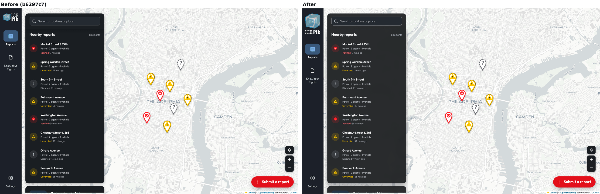

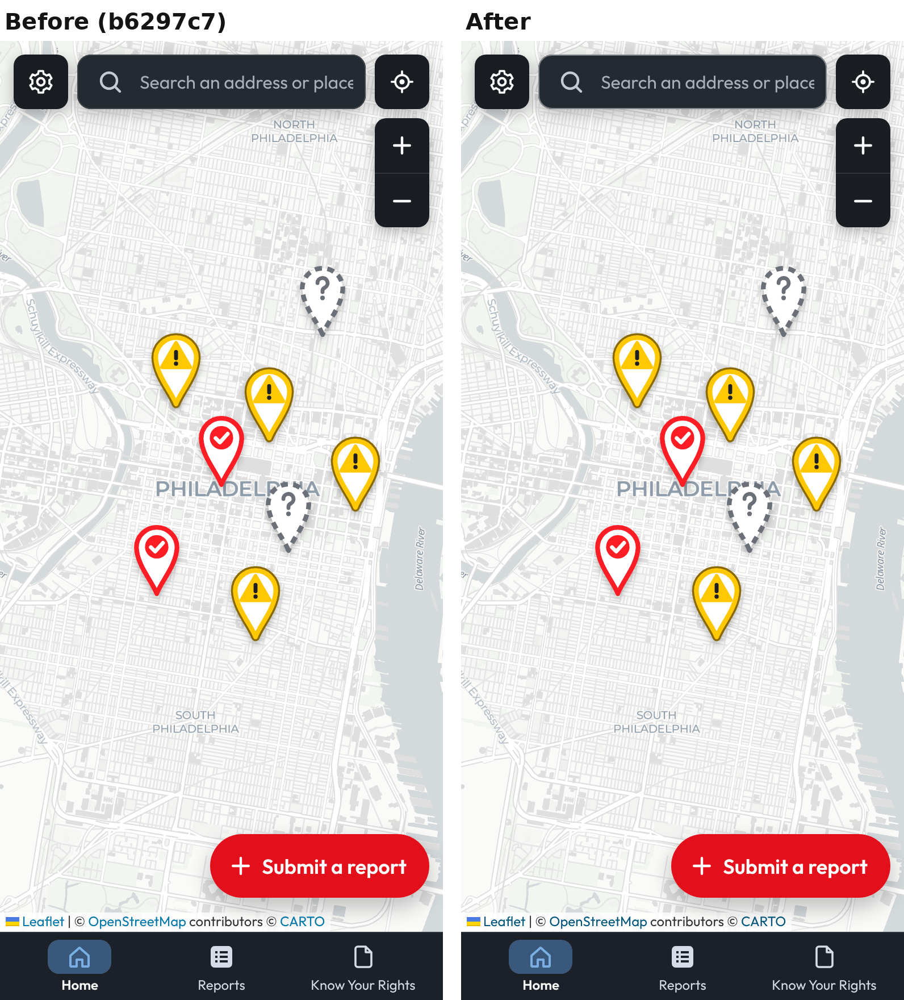

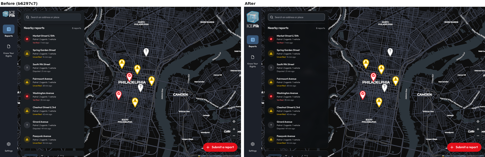

## Alert card

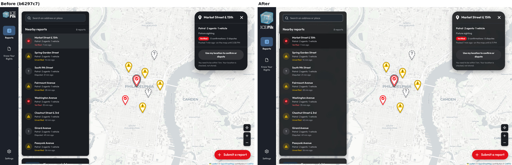

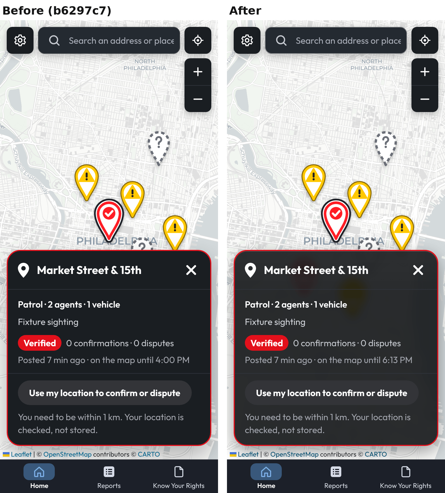

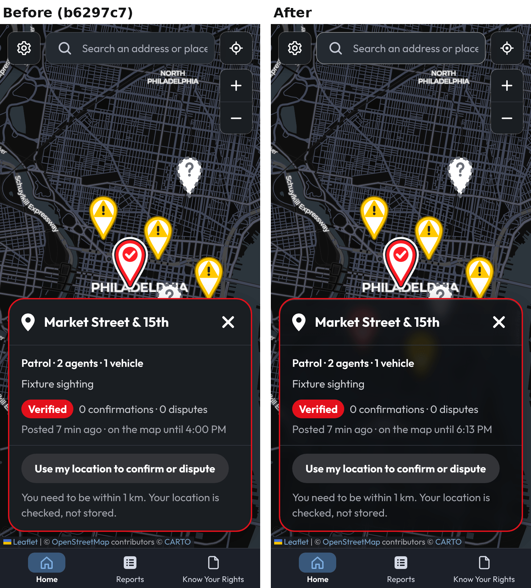

## Log in

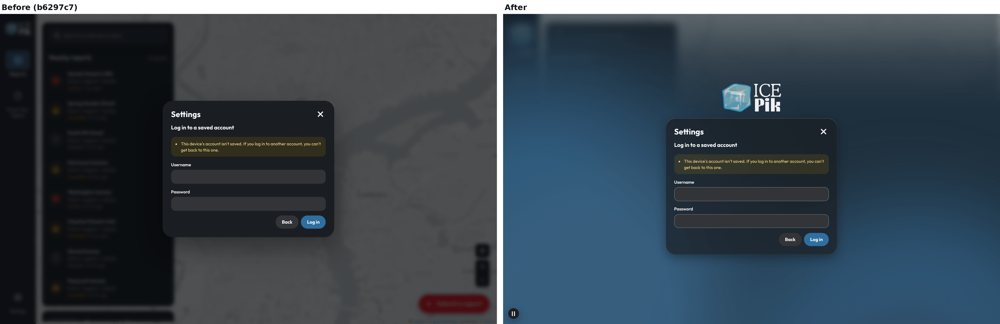

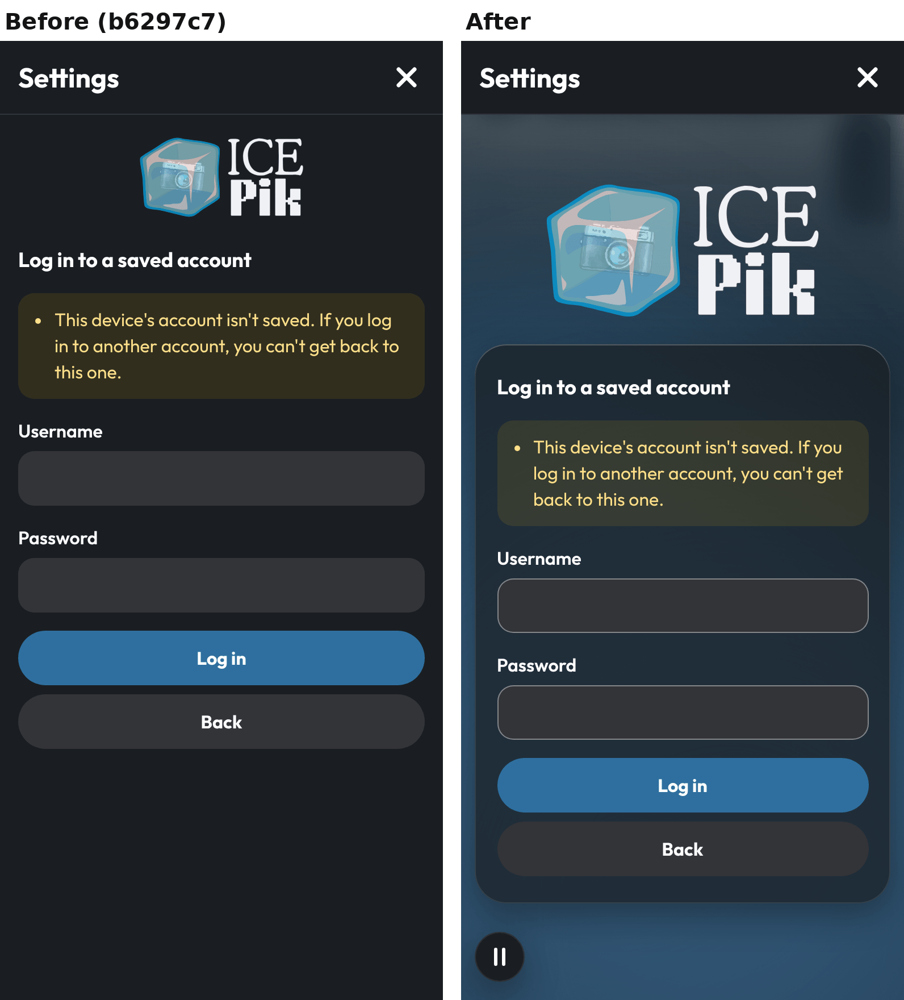

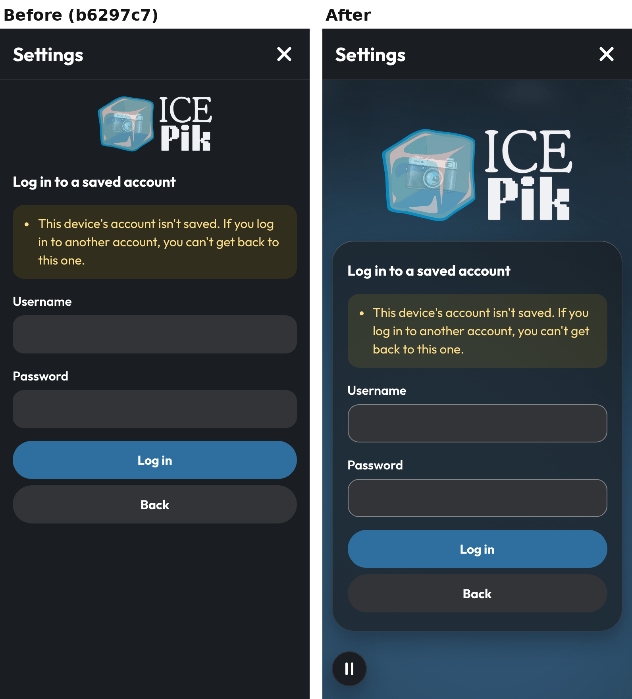

## Consent

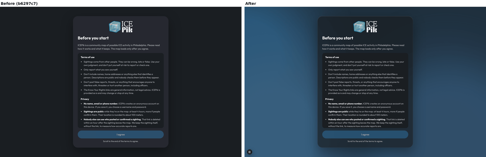

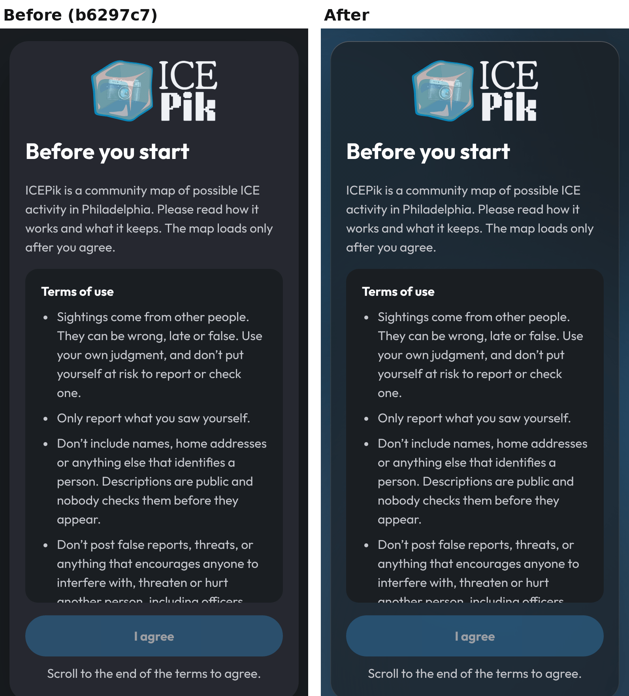
